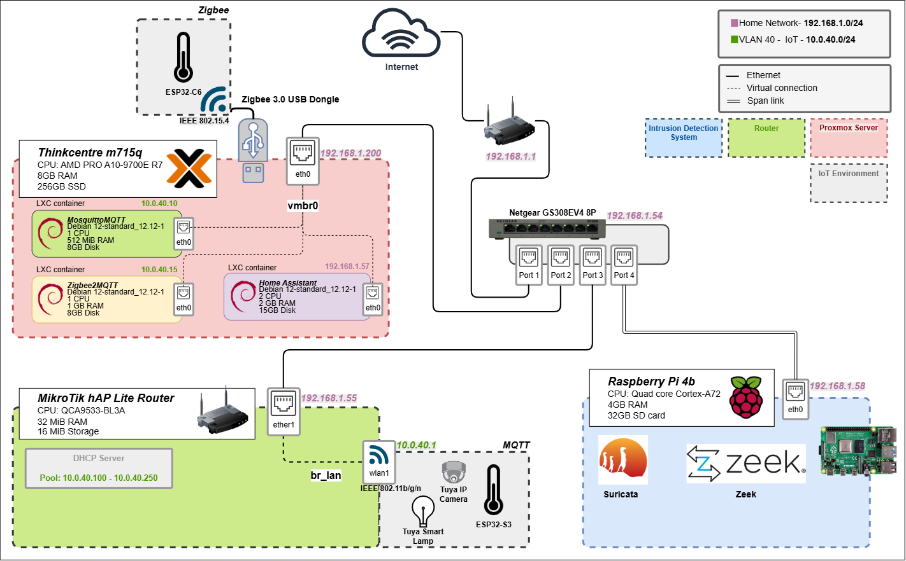

# Intrusion Detection in an IoT Environment

**Evaluating Suricata & Zeek on a Single-Board Computer** · Professional Bachelor Applied Computer Science — HOGENT (2025–2026)

> A self-hosted IoT lab that measures how two popular open-source NIDS engines — **Suricata** and **Zeek** — hold up when monitoring IoT traffic on resource-constrained hardware.

---

## About the Project

IoT devices — ESP32 microcontrollers, Tuya smart plugs, Zigbee sensors — are constantly communicating on the network, yet they ship with minimal compute power and weak security defaults. That combination makes them a favorite target for attackers, and small businesses rarely have the budget or in-house expertise to run licensed security tooling that keeps an eye on these devices. This bachelor's thesis tackles that gap by building a realistic, fully segmented IoT lab and putting two open-source network intrusion detection systems head-to-head in it.

The central question of the research:

> **Which open-source IDS gives you the most network visibility for the least resources — Suricata or Zeek?**

To answer it, the lab recreates genuine IoT traffic, launches attack scenarios against the network, and measures both detection accuracy and the CPU/memory overhead each engine imposes on the NIDS host. The outcome is a practical proof-of-concept blueprint that helps IT teams deploy effective network monitoring in resource-constrained environments.

### Research Goals

-  **Threat landscape** — identify the attacks IoT devices in a small-business network realistically face, from DoS/MQTT floods to protocol abuse and port scans.
-  **Resource footprint** — quantify the CPU and memory usage of Suricata and Zeek on a Raspberry Pi 4 under idle, normal and attack conditions.

## Network Topology

  
   
  <em>Logical network topology of the test environment: IoT devices in VLAN 40, the MQTT broker, Zigbee2MQTT and Home Assistant on the Proxmox host, and the NIDS monitoring via a mirror port.</em>

## Technology Stack

| Layer | Tools |
|---|---|
| **NIDS engines** | Suricata (custom rules) · Zeek (custom scripts) |
| **IoT endpoints** | ESP32-S3 / ESP32-C6 · Tuya devices |
| **Smart-home services** | Eclipse Mosquitto · Zigbee2MQTT · Home Assistant (Proxmox LXC) |
| **Networking** | MikroTik RouterOS · managed switch · VLAN 40 · SPAN/mirror port |
| **Attacks & metrics** | Python (Scapy, Socket) · nmap · tcpdump |

---

*The full thesis (in Dutch) lives in [`bachproef/`](bachproef) — build it with `make_thesis.sh`.*
